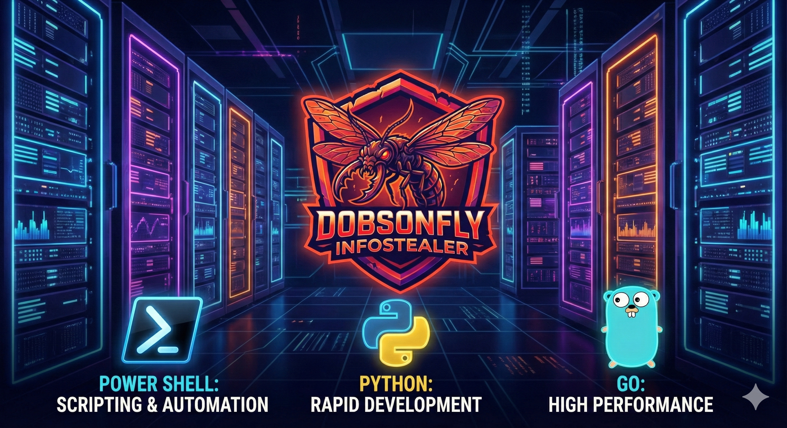

# Dobson (Dobsonfly) - Info Stealer Framework (PoC)

**⚠️ CRITICAL DISCLAIMER ⚠️**

**This software is a Proof of Concept (PoC) developed strictly for ethical execution, cybersecurity research, and educational purposes. It is designed to demonstrate how information stealers and social engineering campaigns operate so that defenders can better recognize and mitigate them.**

* **DO NOT** use this software for illegal, malicious, or unauthorized activities.
* **DO NOT** deploy this software on systems you do not own or have explicit written permission to test.
* **THE AUTHOR IS NOT LIABLE** for any misuse, damage, or legal consequences resulting from the use of this code.
* **THIS IS NOT NOTEPAD++.** It mimics the Notepad++ appearance for credible simulation of social engineering vectors.

---

## Overview

**Dobson** is a modular C2 (Command & Control) and malware framework designed to simulate a targeted supply chain or social engineering attack. It consists of three main components:

1. **Dobsonfly (Payload)**: A python-based information stealer.
2. **Midges (Server)**: A Go-based C2 server that handles exfiltration and acts as a distribution point.
3. **Larvae (Stagers)**: Scripting components for delivery and persistence.

## Components

### 1. Dobsonfly (The Payload)

* **Function**: Information Stealer / Spyware.
* **Capabilities**:
  * **Keylogging**: Captures keystrokes using `pynput`.
  * **Clipboard Hijacking**: Monitors and logs clipboard content via `win32clipboard`.
  * **Secure Exfiltration**: Encrypts stolen data using **NaCl (Networking and Cryptography library)** before transmission to prevent interception by network defense tools (mimicking sophisticated actors).
  * **Persistence**: Designed to run as a background service (`notepad-service`).

### 2. The Spoofed "Notepadd++" Site

The server component hosts a web page designed to look exactly like a legitimate software download page (specifically mimicking **Notepad++**).

* **Social Engineering**: This demonstrates how attackers use typo-squatting (`Notepadd++`) and visual cloning to trick users into downloading malicious binaries.
* **Distribution**: Serves the "infected" installers and portable ZIPs capable of deploying the *Dobsonfly* payload.

### 3. Encryption & C2

* **Communication**: The malware communicates with the C2 server using public-key cryptography (Curve25519, XSalsa20, Poly1305) ensuring that command traffic and exfiltrated data are encrypted.

## Educational Purpose

This project allows security researchers to:

* Analyze signature-based vs. behavior-based detection of Python-compiled malware.
* Test network monitoring tools against encrypted C2 channels.
* Understand the mechanics of "User-assisted" compromise via fake software downloads.
* Demostrate a PoC (Proof of Concept) for CVE-2025-49144 - Links articles regarding this CVE are below

---

# References

### CVE-2025-49144

* [Cyber Proof CVE-2025-49144 Privilege Escalation Vulnerability - Detection, Analysis, and Practical Defenses](https://www.cyberproof.com/blog/cve-2025-49144-notepad-privilege-escalation-vulnerability-detection-analysis-and-practical-defenses/ "Cyber Proof Research Team")
* [Wiz.io Vulnerability Database CVE-2025-49144](https://www.wiz.io/vulnerability-database/cve/cve-2025-49144 "Wiz.io")

### Python Keylogger Research

* [SSRN Python-Based Keylogger Paper](https://papers.ssrn.com/sol3/papers.cfm?abstract_id=5511358 "PDF Download")

*By using this repository, you agree to these terms and accept full responsibility for your actions.*
