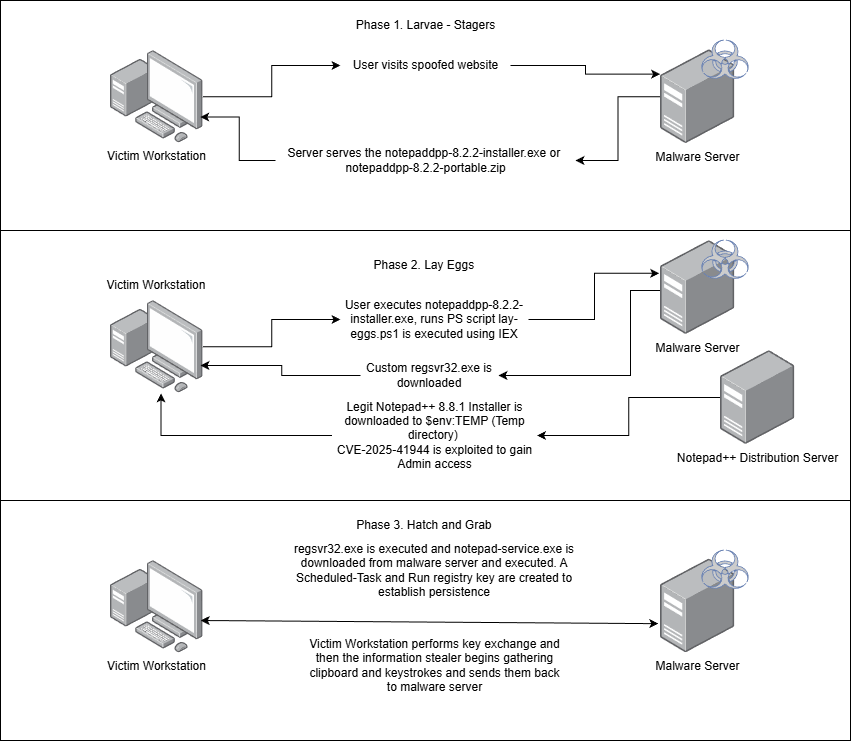

# Phases of Attack

### Diagram



### Phase 1. Larvae - Stagers / Initial Access

##### MITRE ATT&CK Mapping

During this phase, there are two different MiTRE ATT&CK technics utilizes to gain initial access. These techinques and sub-techniques are Phishing (T1566, T1566.001, T1566.002) and Supply Chain Compromise (T1195, T1195.001, T1195.002).

* T1566 - Phishing
  * .001 - Attachment
  * .001 - Link
* T1195 - Supply Chain Compromise
  * .001 - Software Dependencies and Development Tools
  * .002 - Software Supply Chain

##### Phase Exploration

This phase is all about socially engineering the victim to click and download an artifact known as "notepaddpp-8.2.2-installer.exe". This initial stager is what makes everything else happen within seconds! The executable is compiled from a PowerShell script using the PS2EXE program.

```powershell
ps2EXE -InputFile .\larvae\egg.ps1 -OutputFile .\notepaddpp-8.2.2-installer.exe
```

This PowerShell script reaches out to the malware server running to go program listed under the server folder. From here the server serves a PowerShell script called ""lay-eggs.ps1". This script is then executed into memory, and the starts phase 2!


### Phase 2. Lay Eggs - Execution / Privilege Escalation

##### MITRE ATT&CK Mapping

During this phase, there are
