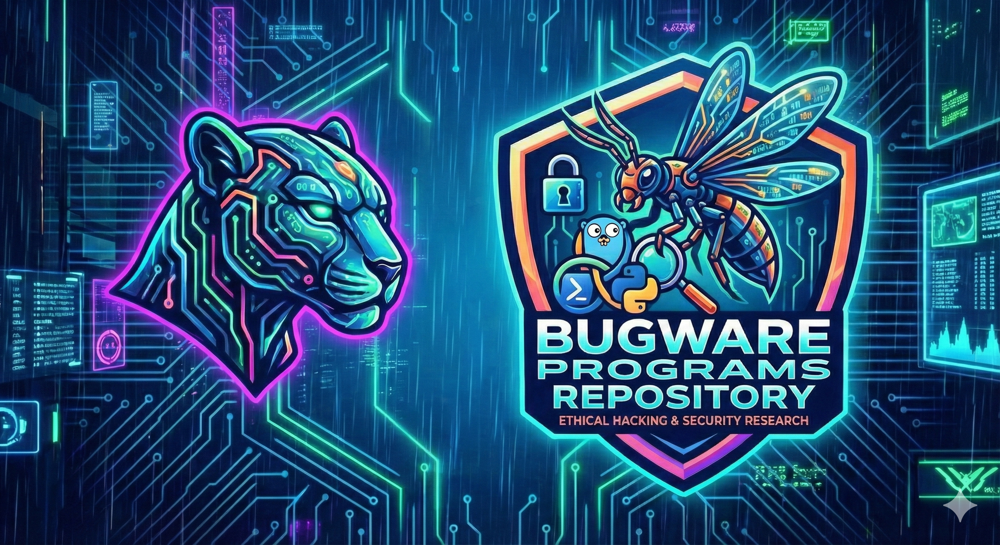

# BugWare

**Disclaimer: This repository is for ethical, academic, and security research purposes only. The projects and code contained herein are Proof of Concept (PoC) demonstrations designed for the progression of cybersecurity education. Do not use this software for illegal or malicious purposes.**

## Overview

BugWare contains a comprehensive collection of cybersecurity tools, Proof of Concepts (PoCs), and simulation environments. These projects are intended to demonstrate various attack vectors, command and control architectures, and vulnerability exploits in a controlled setting to aid in the understanding of defensive postures.

## Project Index

### [1. C2 (Basic Command &amp; Control)](https://github.com/CyberPanther232/BugWare/tree/master/C2 "C2 Branch")

* **Language**: Python (Flask)
* **Description**: A foundational Command and Control (C2) server implementation. It demonstrates the core communication structure between a centralized server and connected clients ("bots").
* **Key Features**:
  * RESTful API endpoints for command retrieval.
  * Command queuing system.
  * Heartbeat mechanism to track active client sessions.

### [2. Cordyceps](https://github.com/CyberPanther232/BugWare/tree/master/Cordyceps "Cordyceps Branch")

* **Language**: Python (Flask), PowerShell
* **Description**: A malware simulation framework designed to demonstrate modern delivery and execution techniques.
* **Key Features**:
  * **Delivery**: Uses a web server to serve payloads.
  * **Execution**: Demonstrates usage of `regsvr32.exe` and PowerShell scripts (`spore.ps1`) for execution, often used to bypass allow-listing policies.
  * **Payloads**: Includes `spore.ps1` as a primary staging payload.

### [3. CuWasp (Cuckoo&#39;s Wasp)](https://github.com/CyberPanther232/BugWare/tree/master/CuWasp "CuWasp Branch")

* **Language**: Python, PowerShell, C
* **Description**: A sophisticated C2 simulation targeting user environments by mimicking legitimate software updates.
* **Key Features**:
  * **Social Engineering**: Components designed to spoof "Chrome Updates" (`chrome_update.html`, `chrome_update.exe`).
  * **Persistence**: Scripts to maintain access via simulated service updates.
  * **Exfiltration**: Handles data exfiltration requests back to the central server.
  * **Native Code**: Includes C source code (`chrome_update_generator.c`) for generating native executables.

### [4. CVE-2025-54100](https://github.com/CyberPanther232/BugWare/tree/master/CVE-2025-54100 "CVE-2025-54100 Branch")

* **Type**: Vulnerability Research / PoC
* **Description**: A directory dedicated to investigating and reproducing specific vulnerability classes (e.g., CVE-2025-54100).
* **Contents**: Includes exploitation scripts such as `script.js` demonstrating Cross-Site Scripting (XSS) vectors associated with the vulnerability.

### [5. Dobson](https://github.com/CyberPanther232/BugWare/tree/master/Dobson "Dobson Branch")

* **Language**: Go (Server), Python (Service), PowerShell (Stagers)
* **Description**: An advanced, multi-stage Command and Control framework utilizing a modular architecture.
* **Key Features**:
  * **Server**: High-performance backend written in Go, featuring "Midges" for bot management.
  * **Security**: Implements cryptographic communications (using NaCl/Box) to secure C2 traffic.
  * **Larvae**: PowerShell-based delivery and staging scripts (`egg.ps1`, `hatch.ps1`).
  * **Dobsonfly**: Python-based payloads designed to run as services (e.g., `notepad-service.py`).

### [6. Logins](https://github.com/CyberPanther232/BugWare/tree/master/logins "Logins Branch")

* **Language**: Python (Flask), HTML/JS
* **Description**: specialized phishing templates and simulations for credential harvesting research.
* **Modules**:
  * **fake_google**: A Flask application simulating a Google login page to demonstrate social engineering and credential interception techniques.

### [7. RustyTick](https://github.com/CyberPanther232/BugWare/tree/master/RustyTick "RustyTick Branch")

* **Language**: Rust
* **Description**: A fast, compiled data exfiltration and archival tool.
* **Key Features**:
  * **Discovery**: Recursively walks filesystem directories.
  * **Archival**: Compresses targeted files into ZIP archives using Rust's `zip` crate.
  * **Exfiltration**: Transmits data over raw TCP sockets to a listening receiver (`rustyTickReceiver`).

### [8. Spicebush](https://github.com/CyberPanther232/BugWare/tree/master/Spicebush "Spicebush Branch")

* **Language**: Python (Flask), SQLite
* **Description**: A deliberately vulnerable e-commerce web application.
* **Purpose**: Serves as a "Firing Range" for web application security testing.
* **Features**:
  * Full shopping cart and checkout logic.
  * User session management.
  * Target surface for SQL Injection, XSS, and logic flaws.

---

*Created for educational purposes by CyberPanther232.*
